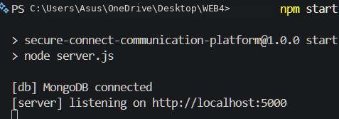
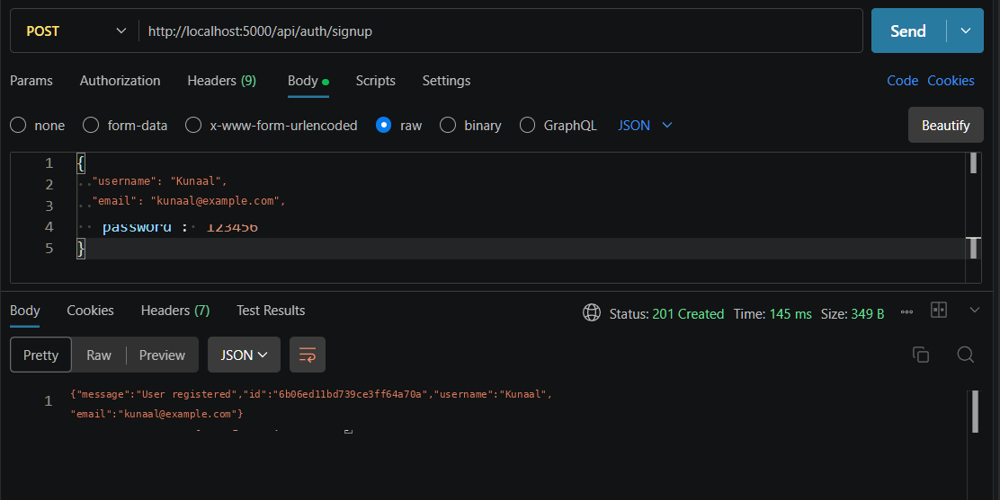
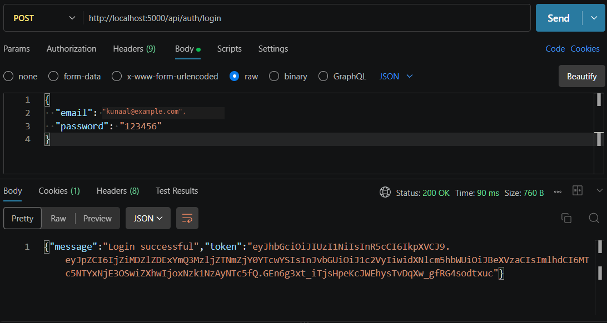
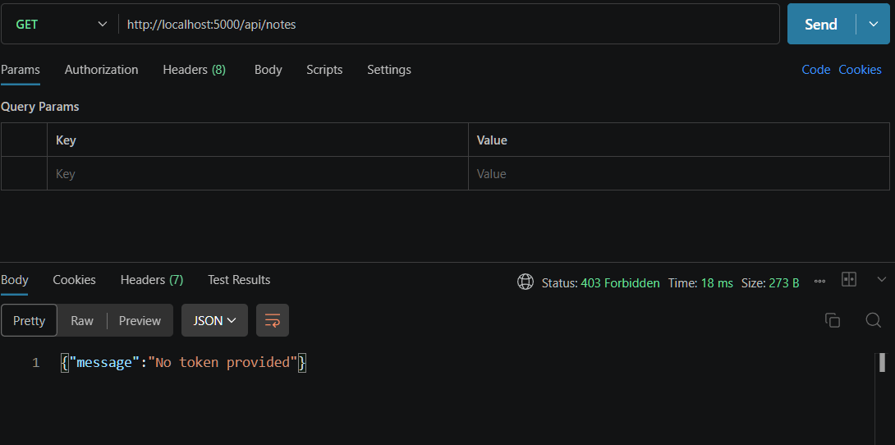
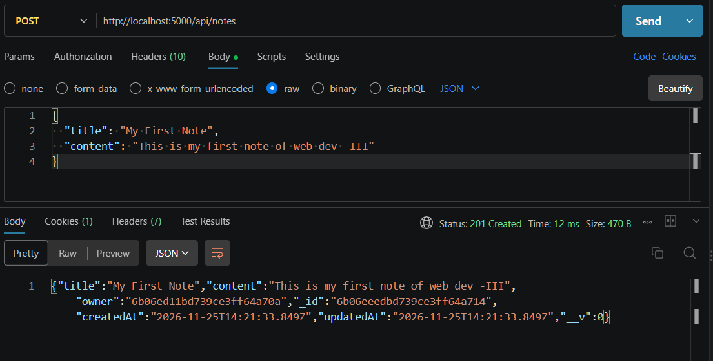
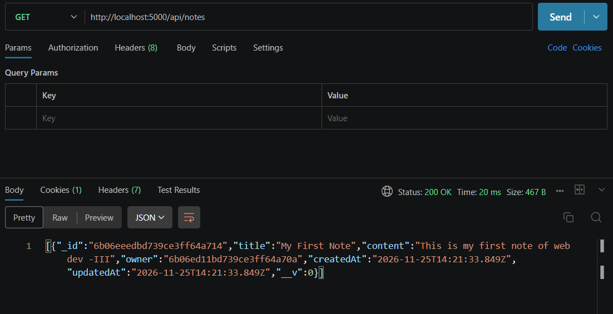
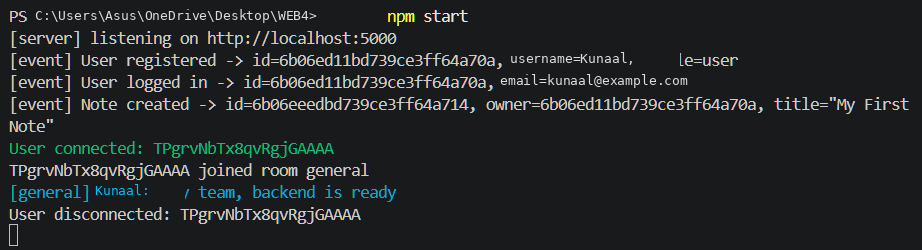

# Secure Connect and Communication Platform (Lab 4)

A backend communication and notes platform built with **Node.js**, **Express**, **MongoDB (Mongoose)**, **JWT**, **bcrypt**, **Socket.IO**, and **EventEmitter**.

## Tech Stack
* **Runtime & Framework:** Node.js, Express.js
* **Database:** MongoDB with Mongoose
* **Authentication & Security:** JWT (`jsonwebtoken`), `bcrypt`, RBAC (`user` / `admin`)
* **Real-Time Communication:** Socket.IO
* **Event Logging:** Node.js `EventEmitter`
* **Configuration:** `dotenv`

## Features Implemented
* **User Authentication:** Signup (`POST /api/auth/signup`) and login (`POST /api/auth/login`) with password hashing and JWT issuance.
* **Role-Based Access Control (RBAC):** Middleware-enforced route protection and role checks (`user` and `admin`).
* **Notes CRUD:** Create and retrieve user notes (`POST /api/notes`, `GET /api/notes`) on protected routes.
* **Real-Time Chat:** Room-based messaging over Socket.IO (`chatMessage` event).
* **Custom Event Logging:** Centralized event logs for user registration, login, and platform activity.

## Project Setup & Run

1. Install dependencies:
   ```bash
   npm install
   ```
2. Configure `.env` with your MongoDB URI, JWT secret, and port (`5000`).
3. Start the server:
   ```bash
   npm start
   ```

## Testing & Output Screenshots

### 1. Server & MongoDB Connection


### 2. User Signup & JWT Login




### 3. Protected Route Without Token (403 Forbidden)


### 4. Notes API With Valid JWT (Create & Fetch)




### 5. Real-Time Chat via Socket.IO
